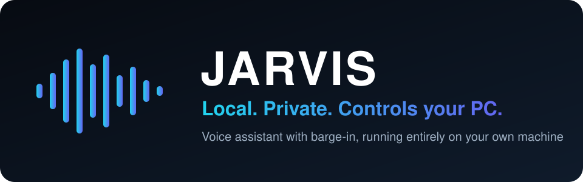
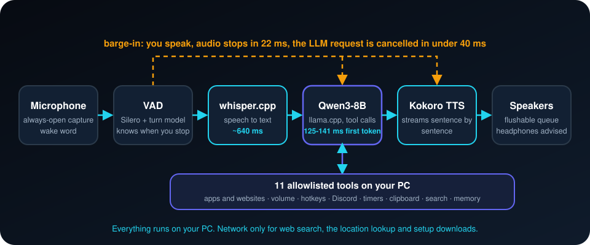

<div align="center">



**Windows용 무료 로컬 음성 비서. 듣고, 말하고, PC의 앱을 제어합니다. 핵심 동작에서는 어떤 데이터도 내 컴퓨터를 떠나지 않습니다.**

[](LICENSE)


[English](README.md) · [Türkçe](README.tr.md) · [简体中文](README.zh-CN.md) · [Русский](README.ru.md) · **한국어**

</div>

---

## 이게 뭔가요?

**"hey jarvis"** 라고 말한 뒤 평소처럼 말하세요. JARVIS는 음성을 텍스트로 바꾸고, 로컬 언어 모델로 생각하고,
소리 내어 답하며, 컴퓨터에서 작업도 할 수 있습니다. 앱과 웹사이트 열기, 볼륨 조절, Discord 음소거,
타이머 설정, 웹 검색 등입니다. 말하는 도중에 끼어들 수 있고(barge-in), 약 22ms 안에 멈춥니다.

- **로컬이고 프라이빗합니다.** 음성 인식(whisper.cpp), 언어 모델(llama.cpp로 실행하는 Qwen3-8B), 음성 합성(Kokoro)이
  모두 내 PC에서 실행됩니다. API 키도, 클라우드 추론도 없습니다.
- **앱을 제어합니다.** 11개 도구: 볼륨, 앱과 웹사이트 실행, 단축키, Discord, 클립보드, 타이머, 창 정보, 웹 검색,
  시스템 정보, 작은 영구 메모리.
- **안전하게 설계되었습니다.** 모델은 등록된 도구만 호출할 수 있습니다. 인자는 검증되고, 알 수 없는 도구는 거부되며,
  URL도 검사됩니다. 앱 종료와 단축키 전송은 음성으로 "네"라고 확인해야 합니다.
- **제대로 동작하는 barge-in.** 끼어들면 멈추고, 짧은 "응", "음" 소리는 끊지 않습니다.
- **주장이 아니라 측정값.** 달성하지 못한 목표를 포함한 실제 지연 시간입니다.

## 작동 방식

<p align="center"></p>

1. **듣기.** 항상 열려 있는 마이크와 호출어("hey jarvis"). 음성 활동 모델과 턴 모델이 말이 끝났는지 판단합니다.
2. **이해하기.** whisper.cpp가 음성을 텍스트로 바꾸고, Qwen3-8B(llama.cpp)가 답하며 등록된 도구를 호출할 수 있습니다.
3. **말하기.** 모델이 아직 쓰는 동안 Kokoro가 문장 단위로 읽어 줍니다.
4. **끼어들 수 있게 유지.** 말을 겹치면 재생이 멈추고 모델 요청이 취소됩니다. 짧은 "응", "음"은 해당되지 않습니다.

## 측정 결과
Windows 11, AMD Radeon RX 6700 XT(12GB, Vulkan), Ryzen 5 X3D에서 측정했습니다.

| 단계 | 목표 | 측정값 |
|---|---|---|
| LLM 첫 토큰까지 시간 | ~250 ms | **125-141 ms** (달성) |
| barge-in 시 말 멈춤 | < 60 ms | **22 ms** (달성) |
| 음성에서 텍스트까지 | ~300 ms | ~640 ms (미달) |
| TTS 첫 소리(CPU) | ~150 ms | ~750 ms (미달) |
| 전체 왕복 | 900-1500 ms | 1450-1750 ms (약간 초과) |

## 개인정보
- **로컬에 남는 것:** 마이크 오디오, 받아쓰기, 언어 모델, 음성 출력, 메모리(데이터 폴더의 JSON 파일).
- **네트워크를 쓰는 것:** `web_search`(DuckDuckGo), `system_info`의 대략적인 위치 조회(IP 기반), 그리고
  `setup.ps1`의 1회성 바이너리·모델 다운로드. 그 외에는 없습니다.

## 빠른 시작
> Windows 10/11, Python 3.11, Vulkan을 지원하는 GPU(모델에 약 5.5GB VRAM 필요), 모델용 디스크 약 6GB.
> **헤드폰을 착용하세요:** 에코 제거 기능이 없습니다.

```powershell
git clone https://github.com/atahan26/jarvis-local-assistant
cd jarvis-local-assistant
.\setup.ps1                                             # venv, 의존성, 바이너리, 약 5.5GB 모델
.\run.ps1                                               # whisper-server와 llama-server 시작
.\.venv\Scripts\python.exe -m src.main --talk           # 대화 시작 ("hey jarvis")
```

## 한계
영어만, Windows만 지원합니다. 8B 모델은 가끔 명령을 잘못 이해합니다. 테스트 중 GPU(Vulkan) 장치가 두 번 사라져
llama-server가 종료된 적이 있으며 `docs/`에 기록했습니다. 화면을 볼 수 없고 `screenshot_describe`는 자리표시용 구현입니다.

## AI 에이전트와 함께 사용하기
클론한 폴더에서 연 Claude Code, Codex, Cursor 등 코딩 에이전트에 아래 블록을 붙여 넣으세요.

```text
Read AGENTS.md and README.md first. This is a local Windows voice assistant (whisper.cpp, llama.cpp,
Kokoro). Help me with: <원하는 작업>. Follow the safety rules in AGENTS.md and do not weaken the
tool allowlist.
```

## 프로젝트 소개
개인 프로젝트입니다. 작성자가 목표를 정하고, 아키텍처를 고르고, 실제 PC에서 테스트하고, 무엇을 남길지 결정했습니다.
코드의 대부분은 [Claude Code](https://claude.com/claude-code)로 작성했습니다. PC 제어권을 맡기기 전에 코드를 직접 읽어 보세요.

## 라이선스
[MIT](LICENSE). 이름은 가상의 비서에서 따온 것이며, 이 프로젝트는 Marvel, Disney, Microsoft와 무관합니다.
