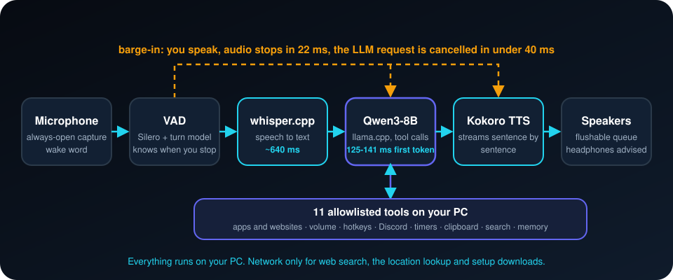

<div align="center">


**A free, local voice assistant for Windows. It listens, talks back, and controls the apps on your PC. Nothing leaves your machine for the core loop.**

[](LICENSE)


**English** · [Türkçe](README.tr.md) · [简体中文](README.zh-CN.md) · [Русский](README.ru.md) · [한국어](README.ko.md)

</div>

---

## What is this?

Say **"hey jarvis"**, then talk normally. JARVIS transcribes you, thinks with a local language model, answers out loud,
and can act on your computer: open apps and websites, change the volume, mute Discord, set timers, search the web.
You can interrupt it mid-sentence (barge-in) and it stops in about 22 ms.

- **Local and private.** Speech recognition ([whisper.cpp](https://github.com/ggml-org/whisper.cpp)), the language model
  (Qwen3-8B via [llama.cpp](https://github.com/ggml-org/llama.cpp)) and speech synthesis (Kokoro) all run on your PC. No API keys, no cloud inference.
- **Controls your apps.** 11 tools: volume, app and website launcher, hotkeys, Discord mute/deafen, clipboard, timers,
  window info, web search, system info, conversation control and a small persistent memory.
- **Safe by design.** The model can only call registered tools. Arguments are validated, unknown tools are refused, URLs
  are checked, and closing apps or sending hotkeys needs a spoken "yes".
- **Barge-in that works.** Interrupt it and it stops talking; short "yeah" and "mhm" do not interrupt it.
- **Measured, not claimed.** Real latencies below, including the targets it misses.

## How it works

<p align="center"></p>

1. **Listen.** An always-open microphone stream and a wake word ("hey jarvis"). A voice-activity model and a turn model decide when you have finished.
2. **Understand.** whisper.cpp turns speech into text; Qwen3-8B (llama.cpp) answers and can call registered tools.
3. **Speak.** Kokoro streams the reply sentence by sentence while the model is still writing.
4. **Stay interruptible.** If you talk over it, playback stops and the model request is cancelled. Short "yeah" and "mhm" do not count.

## Measured results

Measured on Windows 11 with an AMD Radeon RX 6700 XT (12 GB, Vulkan) and a Ryzen 5 X3D.

| Stage | Target | Measured | |
|---|---|---|---|
| LLM time to first token | ~250 ms | **125-141 ms** | met |
| Stop talking on barge-in | < 60 ms | **22 ms** | met |
| Cancel the LLM on barge-in | < 40 ms | **< 40 ms** (asserted in tests) | met |
| Speech to text | ~300 ms | ~640 ms | missed |
| First audio from TTS (CPU) | ~150 ms | ~750 ms | missed |
| Full round trip | 900-1500 ms | **1450-1750 ms** | slightly over |

The TTS floor on CPU is about 300 ms whatever the text length, so the first-audio target cannot be met with Kokoro on CPU.
A tool turn costs two LLM round trips (a volume change takes about 2.3 s, a web search about 8 s, almost all of it the search itself).
Switching `whisper.model` to the smaller `ggml-base.en-q5_1.bin` would take roughly 290 ms off.

## Tools

| Tool | What it does |
|---|---|
| `system_volume` | get, set, up, down, mute, unmute |
| `app_control` | launch, focus, close, status for apps **and websites** (allowlisted, `close` asks first) |
| `send_hotkey` | allowlisted key combinations, max four keys, asks first |
| `discord_control` | toggle mute and deafen through keyboard shortcuts (no Discord library, no self-bot) |
| `web_search` | DuckDuckGo, only for current facts |
| `clipboard` | read, write, clear |
| `timer` | set, cancel, list; announces itself when it fires |
| `window_info` | focused window, window list |
| `system_info` | time, date, location (honest about VPNs), battery, performance |
| `conversation_control` | sleep, stop talking, repeat, forget |
| `memory` | remembers facts between sessions (capped at 60) |

## Privacy: what stays local

- **Local:** microphone audio, transcription, the language model, speech output, memory (a JSON file in your data folder).
- **Network:** `web_search` (DuckDuckGo), the approximate-location lookup in `system_info` (IP geolocation), and the one-time
  download of binaries and models in `setup.ps1`. Nothing else.

## Quick start

> Windows 10/11, Python 3.11, a GPU with Vulkan (the model needs about 5.5 GB of VRAM), about 6 GB of disk for models. **Wear headphones**: there is no echo cancellation.

```powershell
git clone https://github.com/atahan26/jarvis-local-assistant
cd jarvis-local-assistant
.\setup.ps1                                             # venv, dependencies, binaries, ~5.5 GB of models
.\run.ps1                                               # start whisper-server and llama-server
.\.venv\Scripts\python.exe -m src.main --talk           # talk to it ("hey jarvis")
```

Other modes: `--listen` (speech to text with latencies), `--chat` (typed chat), `--speak` (typed text to speech).
All thresholds are in `config.yaml`. Override them in a local `config.local.yaml` (ignored by git). Stop the servers with `.\run.ps1 -Stop`.

## Limits you should know

- English only. Windows only. Headphones recommended.
- The 8B model sometimes refuses or misreads a command; the system prompt and tool descriptions are tuned to reduce this.
- The GPU (Vulkan) device was lost twice during testing and llama-server died. It is documented in `docs/`.
- No screen vision. `screenshot_describe` is a stub that says it cannot see.

## Use it with an AI agent

Paste this into Claude Code, Codex, Cursor or any coding agent opened in your clone:

```text
Read AGENTS.md and README.md first. This is a local Windows voice assistant (whisper.cpp, llama.cpp,
Kokoro). Help me with: <what you want, for example "add a tool that opens my calendar" or "tune
the endpointing">. Follow the safety rules in AGENTS.md and do not weaken the tool allowlist.
```

## About this project

A personal project. The author set the goals, chose the architecture, tested it on a real PC and decided what to keep.
Most of the code was written with [Claude Code](https://claude.com/claude-code). Read the code before giving it control of your PC.
The original build spec is in [`docs/JARVIS_SPEC.md`](docs/JARVIS_SPEC.md).

## License

[MIT](LICENSE). The name is a nod to a fictional assistant; this project is not affiliated with Marvel, Disney or Microsoft.

<sub>Keywords: local voice assistant, offline AI assistant, privacy, whisper.cpp, llama.cpp, Qwen3, Kokoro TTS, barge-in, Windows, tool calling, Python</sub>
