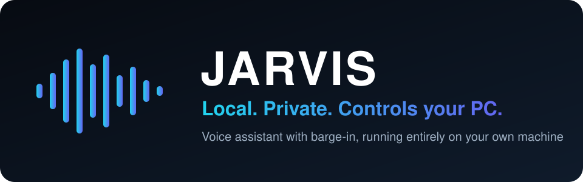

<div align="center">



**Бесплатный локальный голосовой ассистент для Windows. Он слушает, отвечает голосом и управляет приложениями на вашем ПК. В основном цикле данные не покидают ваш компьютер.**

[](LICENSE)


[English](README.md) · [Türkçe](README.tr.md) · [简体中文](README.zh-CN.md) · **Русский** · [한국어](README.ko.md)

</div>

---

## Что это?

Скажите **"hey jarvis"** и говорите как обычно. JARVIS переводит речь в текст, думает с помощью локальной языковой модели,
отвечает голосом и может действовать на вашем компьютере: открывать приложения и сайты, менять громкость,
отключать звук в Discord, ставить таймеры, искать в интернете. Его можно перебить на полуслове (barge-in),
он замолкает примерно за 22 мс.

- **Локально и приватно.** Распознавание речи (whisper.cpp), языковая модель (Qwen3-8B через llama.cpp) и синтез речи
  (Kokoro) работают на вашем ПК. Ключи API не нужны, облачного вывода нет.
- **Управляет вашими приложениями.** 11 инструментов: громкость, запуск приложений и сайтов, горячие клавиши, Discord,
  буфер обмена, таймеры, информация об окнах, веб-поиск, информация о системе и небольшая постоянная память.
- **Безопасность заложена в дизайн.** Модель может вызывать только зарегистрированные инструменты. Аргументы проверяются,
  неизвестные инструменты отклоняются, URL проверяются. Закрытие приложений и отправка горячих клавиш требуют голосового "да".
- **Barge-in, который работает.** Перебейте его, и он замолчит; короткие "ага" и "угу" его не прерывают.
- **Измерено, а не заявлено.** Реальные задержки, включая недостигнутые цели.

## Измеренные результаты
Измерено в Windows 11 на AMD Radeon RX 6700 XT (12 ГБ, Vulkan) и Ryzen 5 X3D.

| Этап | Цель | Измерено |
|---|---|---|
| Время до первого токена LLM | ~250 мс | **125-141 мс** (достигнуто) |
| Остановка речи при barge-in | < 60 мс | **22 мс** (достигнуто) |
| Речь в текст | ~300 мс | ~640 мс (не достигнуто) |
| Первый звук TTS (CPU) | ~150 мс | ~750 мс (не достигнуто) |
| Полный цикл | 900-1500 мс | 1450-1750 мс (немного выше) |

## Приватность
- **Остаётся локально:** звук микрофона, транскрипция, языковая модель, голосовой вывод и память (JSON-файл в папке данных).
- **Использует сеть:** `web_search` (DuckDuckGo), приблизительное определение местоположения в `system_info`
  (по IP) и однократная загрузка бинарных файлов и моделей через `setup.ps1`. Больше ничего.

## Быстрый старт
> Windows 10/11, Python 3.11, GPU с поддержкой Vulkan (модели нужно около 5,5 ГБ видеопамяти), около 6 ГБ на диске
> для моделей. **Используйте наушники:** эхоподавления нет.

```powershell
git clone https://github.com/atahan26/jarvis-local-assistant
cd jarvis-local-assistant
.\setup.ps1                                             # venv, зависимости, бинарные файлы, ~5,5 ГБ моделей
.\run.ps1                                               # запустить whisper-server и llama-server
.\.venv\Scripts\python.exe -m src.main --talk           # говорить ("hey jarvis")
```

## Ограничения
Только английский язык и только Windows. Модель на 8B иногда неверно понимает команды. Во время тестов устройство GPU
(Vulkan) дважды терялось, и llama-server падал; это описано в `docs/`. Экран он не видит: `screenshot_describe` лишь заглушка.

## Использование с ИИ-агентом
Скопируйте этот блок в Claude Code, Codex, Cursor или другой кодовый агент, открытый в вашем клоне:

```text
Read AGENTS.md and README.md first. This is a local Windows voice assistant (whisper.cpp, llama.cpp,
Kokoro). Help me with: <что вы хотите>. Follow the safety rules in AGENTS.md and do not weaken the
tool allowlist.
```

## О проекте
Личный проект. Автор поставил цели, выбрал архитектуру, проверил её на реальном ПК и решил, что оставить.
Большая часть кода написана с помощью [Claude Code](https://claude.com/claude-code). Прочитайте код, прежде чем давать ему управление ПК.

## Лицензия
[MIT](LICENSE). Название отсылает к вымышленному ассистенту; проект не связан с Marvel, Disney или Microsoft.
