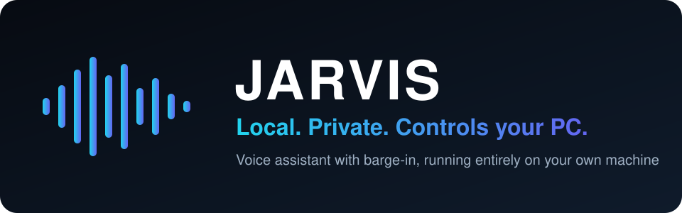
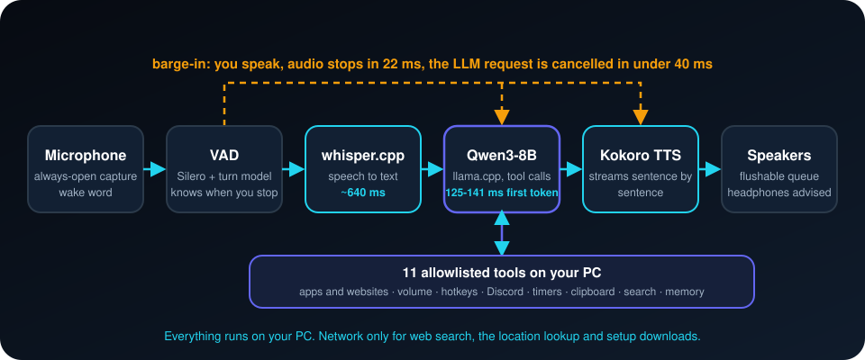

<div align="center">



**Windows için ücretsiz, yerel bir sesli asistan. Dinler, konuşur ve bilgisayarındaki uygulamaları kontrol eder. Ana döngüde hiçbir veri makinenden çıkmaz.**

[](LICENSE)


[English](README.md) · **Türkçe** · [简体中文](README.zh-CN.md) · [Русский](README.ru.md) · [한국어](README.ko.md)

</div>

---

## Nedir?

**"hey jarvis"** de, sonra normal konuş. JARVIS seni yazıya çevirir, yerel bir dil modeliyle düşünür, sesli cevap verir
ve bilgisayarında işlem yapabilir: uygulama ve web sitesi açar, ses seviyesini değiştirir, Discord'u susturur,
zamanlayıcı kurar, web'de arama yapar. Cümlesinin ortasında sözünü kesebilirsin (barge-in), yaklaşık 22 ms içinde susar.

- **Yerel ve gizli.** Konuşma tanıma (whisper.cpp), dil modeli (llama.cpp üzerinden Qwen3-8B) ve ses sentezi (Kokoro)
  bilgisayarında çalışır. API anahtarı ve bulut çıkarımı yok.
- **Uygulamalarını kontrol eder.** 11 araç: ses, uygulama ve site açma, kısayollar, Discord, pano, zamanlayıcı,
  pencere bilgisi, web arama, sistem bilgisi ve küçük bir kalıcı bellek.
- **Tasarımı güvenli.** Model yalnızca kayıtlı araçları çağırabilir. Argümanlar doğrulanır, bilinmeyen araçlar
  reddedilir, URL'ler denetlenir. Uygulama kapatma ve kısayol göndermek için sesli "evet" gerekir.
- **Çalışan barge-in.** Sözünü kesersen susar, kısa "evet" ve "hmm" sesleri onu kesmez.
- **Ölçülmüş sonuçlar.** Gerçek gecikmeler, kaçırılan hedefler dahil.

## Nasıl çalışır

<p align="center"></p>

1. **Dinle.** Sürekli açık mikrofon ve bir uyandırma sözü ("hey jarvis"). Ses etkinliği ve tur modeli konuşmanı ne zaman bitirdiğini belirler.
2. **Anla.** whisper.cpp konuşmayı metne çevirir; Qwen3-8B (llama.cpp) cevap verir ve kayıtlı araçları çağırabilir.
3. **Konuş.** Model hâlâ yazarken Kokoro cevabı cümle cümle seslendirir.
4. **Kesilebilir kal.** Üstüne konuşursan ses durur ve model isteği iptal edilir. Kısa "evet" ve "hmm" sayılmaz.

## Ölçülen sonuçlar
AMD Radeon RX 6700 XT (12 GB, Vulkan) ve Ryzen 5 X3D ile Windows 11'de ölçüldü.

| Aşama | Hedef | Ölçülen |
|---|---|---|
| LLM ilk token süresi | ~250 ms | **125-141 ms** (tuttu) |
| Barge-in'de susma | < 60 ms | **22 ms** (tuttu) |
| Konuşmadan metne | ~300 ms | ~640 ms (tutmadı) |
| TTS ilk ses (CPU) | ~150 ms | ~750 ms (tutmadı) |
| Toplam gidiş-dönüş | 900-1500 ms | 1450-1750 ms (biraz aştı) |

## Gizlilik
- **Yerel kalanlar:** mikrofon sesi, yazıya çevirme, dil modeli, ses çıkışı ve bellek (veri klasöründe bir JSON dosyası).
- **Ağa çıkanlar:** `web_search` (DuckDuckGo), `system_info` içindeki yaklaşık konum sorgusu (IP konumu) ve
  `setup.ps1` ile bir kerelik binary ve model indirme. Başka hiçbir şey yok.

## Hızlı başlangıç
> Windows 10/11, Python 3.11, Vulkan destekli bir GPU (model yaklaşık 5,5 GB VRAM ister), modeller için yaklaşık 6 GB disk.
> **Kulaklık tak:** yankı engelleme yok.

```powershell
git clone https://github.com/atahan26/jarvis-local-assistant
cd jarvis-local-assistant
.\setup.ps1                                             # venv, bağımlılıklar, binary'ler, ~5,5 GB model
.\run.ps1                                               # whisper-server ve llama-server'ı başlat
.\.venv\Scripts\python.exe -m src.main --talk           # konuş ("hey jarvis")
```

## Sınırlar
Yalnızca İngilizce ve yalnızca Windows. 8B model bazen komutu yanlış anlar. Test sırasında GPU (Vulkan) aygıtı iki kez
kayboldu ve llama-server kapandı, `docs/` içinde belgelendi. Ekranı göremez, `screenshot_describe` bir taslaktır.

## Yapay zeka ajanıyla kullanım
Bu bloğu klonunda açık olan Claude Code, Codex, Cursor veya başka bir kodlama ajanına yapıştır:

```text
Read AGENTS.md and README.md first. This is a local Windows voice assistant (whisper.cpp, llama.cpp,
Kokoro). Help me with: <ne istediğin>. Follow the safety rules in AGENTS.md and do not weaken the
tool allowlist.
```

## Bu proje hakkında
Kişisel bir proje. Yazar hedefleri koydu, mimariyi seçti, gerçek bir bilgisayarda test etti ve neyin kalacağına karar verdi.
Kodun büyük kısmı [Claude Code](https://claude.com/claude-code) ile yazıldı. Bilgisayarının kontrolünü vermeden önce kodu oku.

## Lisans
[MIT](LICENSE). İsim kurgusal bir asistana selamdır; proje Marvel, Disney veya Microsoft ile bağlantılı değildir.
