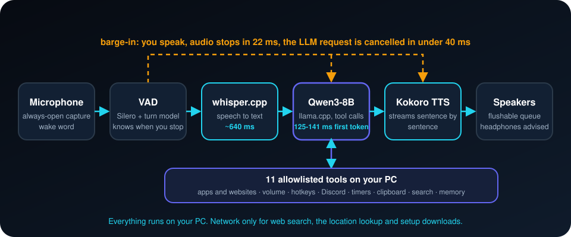

<div align="center">


**适用于 Windows 的免费本地语音助手。它能听、能说，还能控制你电脑上的应用。核心流程中没有任何数据离开你的机器。**

[](LICENSE)


[English](README.md) · [Türkçe](README.tr.md) · **简体中文** · [Русский](README.ru.md) · [한국어](README.ko.md)

</div>

---

## 这是什么？

说一声 **"hey jarvis"**，然后正常说话。JARVIS 会把你的话转成文字，用本地语言模型思考，用语音回答，
并能操作你的电脑：打开应用和网站、调节音量、让 Discord 静音、设置计时器、搜索网页。
你可以在它说话时随时打断（barge-in），它大约 22 毫秒内就会停下。

- **本地且私密。** 语音识别（whisper.cpp）、语言模型（通过 llama.cpp 运行 Qwen3-8B）和语音合成（Kokoro）都在你的电脑上运行。不需要 API 密钥，没有云端推理。
- **控制你的应用。** 11 个工具：音量、应用和网站启动、快捷键、Discord、剪贴板、计时器、窗口信息、网页搜索、系统信息和一个小型持久记忆。
- **设计上注重安全。** 模型只能调用已注册的工具。参数会被校验，未知工具会被拒绝，URL 会被检查。关闭应用和发送快捷键需要口头确认"是"。
- **真正可用的打断功能。** 你打断它，它就停；简短的"嗯""对"不会打断它。
- **有实测数据。** 真实的延迟数据，包括没达到的目标。

## 工作原理

<p align="center"></p>

1. **聆听。** 始终开启的麦克风和唤醒词（"hey jarvis"）。语音活动模型和轮次模型判断你何时说完。
2. **理解。** whisper.cpp 把语音转成文字；Qwen3-8B（llama.cpp）作答，并可调用已注册的工具。
3. **说话。** 模型还在生成时，Kokoro 就逐句合成并播放。
4. **随时可打断。** 你一开口，播放停止，模型请求被取消。简短的"嗯""对"不算。

## 实测结果
在 Windows 11、AMD Radeon RX 6700 XT（12 GB，Vulkan）和 Ryzen 5 X3D 上测得。

| 阶段 | 目标 | 实测 |
|---|---|---|
| LLM 首个 token 时间 | ~250 ms | **125-141 ms**（达标） |
| 被打断时停止说话 | < 60 ms | **22 ms**（达标） |
| 语音转文字 | ~300 ms | ~640 ms（未达标） |
| TTS 首个音频（CPU） | ~150 ms | ~750 ms（未达标） |
| 完整往返 | 900-1500 ms | 1450-1750 ms（略超） |

## 隐私
- **保留在本地：** 麦克风音频、转写、语言模型、语音输出和记忆（数据文件夹中的一个 JSON 文件）。
- **会联网：** `web_search`（DuckDuckGo）、`system_info` 中的大致位置查询（IP 定位），以及 `setup.ps1` 一次性下载程序和模型。仅此而已。

## 快速开始
> Windows 10/11、Python 3.11、支持 Vulkan 的 GPU（模型约需 5.5 GB 显存）、约 6 GB 磁盘空间存放模型。**请戴耳机：** 没有回声消除。

```powershell
git clone https://github.com/atahan26/jarvis-local-assistant
cd jarvis-local-assistant
.\setup.ps1                                             # 虚拟环境、依赖、程序、约 5.5 GB 模型
.\run.ps1                                               # 启动 whisper-server 和 llama-server
.\.venv\Scripts\python.exe -m src.main --talk           # 开始对话（"hey jarvis"）
```

## 局限
仅支持英语，仅支持 Windows。8B 模型有时会误解指令。测试期间 GPU（Vulkan）设备丢失过两次，导致 llama-server 退出，已记录在 `docs/` 中。它看不到屏幕，`screenshot_describe` 只是占位实现。

## 与 AI 代理一起使用
把下面这段话复制到在你的克隆目录中打开的 Claude Code、Codex、Cursor 或其他编码代理：

```text
Read AGENTS.md and README.md first. This is a local Windows voice assistant (whisper.cpp, llama.cpp,
Kokoro). Help me with: <你想做什么>. Follow the safety rules in AGENTS.md and do not weaken the
tool allowlist.
```

## 关于本项目
个人项目。作者设定目标、选择架构、在真实电脑上测试并决定保留什么。大部分代码由 [Claude Code](https://claude.com/claude-code) 编写。在让它控制你的电脑之前，请先阅读代码。

## 许可证
[MIT](LICENSE)。名称致敬一个虚构的助手；本项目与 Marvel、Disney 或 Microsoft 无关。
